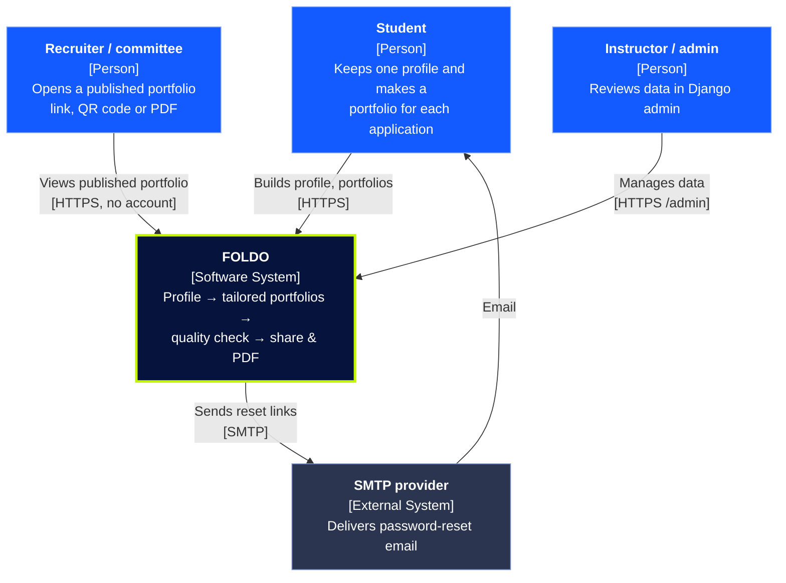
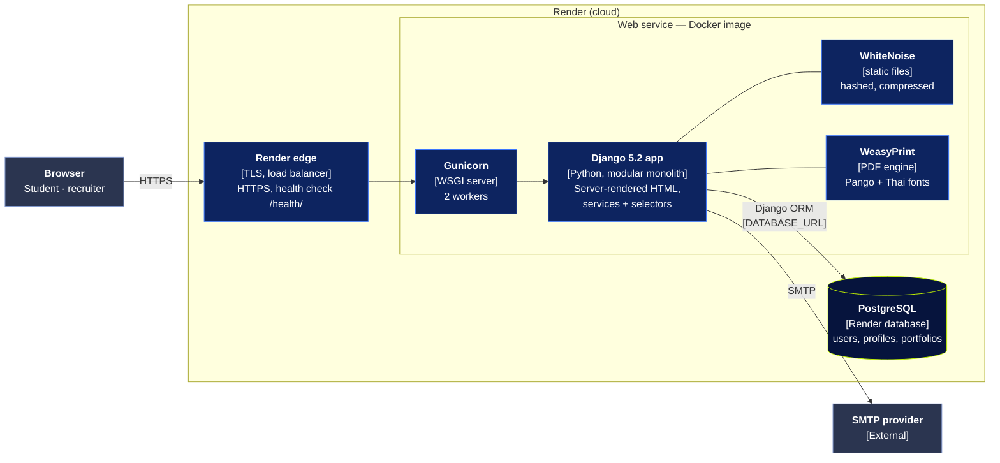
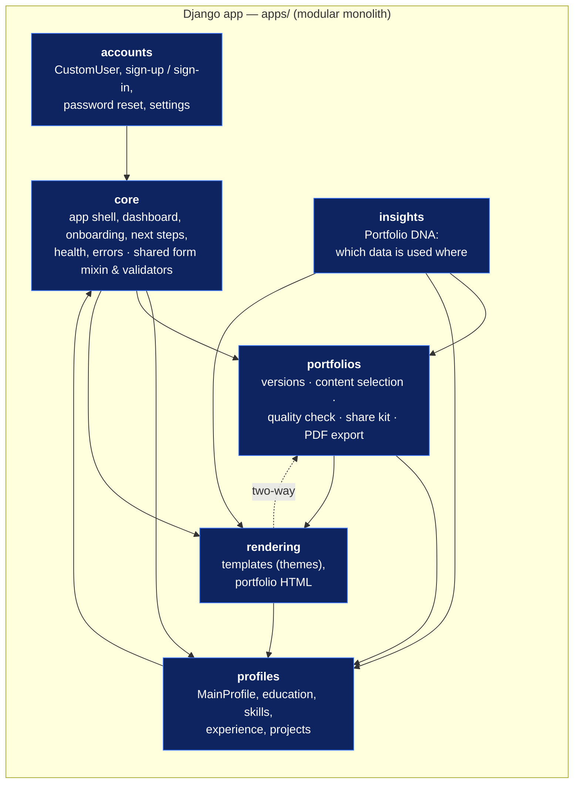
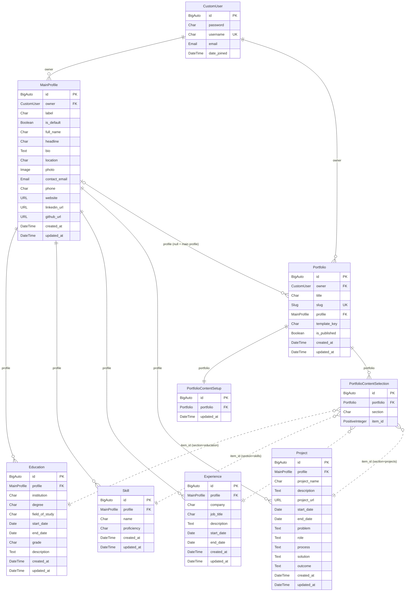

# Architecture

This document explains how the FOLDO Django project is organised: the apps and
their responsibilities, URL routing, templates, static files, the current
(near-empty) model layer, and the intended data flow as MVP features land.

## High-level shape

FOLDO is a **server-rendered Django monolith**. Django renders HTML with the
template engine, Bootstrap 5 styles it, and a small amount of ES6 JavaScript
progressively enhances the page. There is no separate JavaScript application or
REST API in the foundation; those are not required by the course stack.

FOLDO is a **modular monolith** with a **4-tier layered architecture** inside
every app (presentation → validation → business logic → data access).

## C4 model

Diagram sources live in [`docs/diagrams/`](diagrams/) (`.mmd`, rendered by GitHub);
the `.png` files next to them are for slides.

### Level 1 — System context



### Level 2 — Containers (production on Render)



| Container | Technology | Responsibility |
| --------- | ---------- | -------------- |
| Edge | Render load balancer | TLS termination, HTTPS redirect, health checks on `/health/`. |
| Application server | Gunicorn (Docker image) | Runs Django through `config/wsgi.py`; `scripts/start.sh` migrates first. |
| Web application | Django 5.2 | All business logic; server-rendered HTML (MVT) with services and selectors. |
| Static files | WhiteNoise | Serves `collectstatic` output with hashed names and compression. |
| PDF engine | WeasyPrint + Pango, Noto fonts | Renders a portfolio to PDF, including Thai text. |
| Database | PostgreSQL (SQLite in local development) | Persistent data via the Django ORM (`DATABASE_URL`). |
| Email | External SMTP | Password-reset links (`EMAIL_*` settings). |

Local development runs only `runserver` + SQLite; Redis is used only when
`REDIS_URL` is set.

### Level 3 — Components (inside the Django container)



Arrows are real imports, checked against the code. Two dependencies point both
ways and are worth knowing before refactoring:

- **profiles ↔ core**: profiles use core's shared form mixin and validators;
  core's dashboard reads profiles. Core's next-step helpers are imported inside
  functions in profiles (not at module load), so there is no import cycle.
- **portfolios ↔ rendering**: portfolios render through rendering's themes;
  rendering's preview uses portfolio content selection.

## Data model (ERD)

Generated from the Django models. Dotted lines are logical references:
`PortfolioContentSelection.item_id` points at a row in the table named by
`section`, deliberately without a foreign key (deleting a profile item never
blocks or cascades into a portfolio).



## The `config/` package (Django project)

`config/` is the Django **project** package — configuration only, no business
logic.

| File | Responsibility |
| ---- | -------------- |
| `settings.py` | Single env-based settings module (see below). |
| `urls.py` | Root URLconf: mounts the admin and each app's URLs, defines error handlers. |
| `wsgi.py` | WSGI entry point (used by `runserver` and any WSGI server). |
| `asgi.py` | ASGI entry point (kept for future async support). |

### Why one settings module?

For a project of this size, separate `base/dev/prod` settings modules add import
complexity and a common source of bugs ("which settings am I running?"). Instead
`config/settings.py` reads environment variables through small `env_*` helpers:

- Unset variables fall back to **development-safe** defaults (SQLite, `DEBUG=True`).
- Setting `DJANGO_DEBUG=False` and the `DB_*` / `REDIS_URL` variables switches
  the *same* module into production behaviour, including HTTPS redirect, secure
  cookies, HSTS and trusted-proxy handling.

This keeps one obvious place to read configuration and avoids duplicating
settings across files.

## Apps and their responsibilities

FOLDO is a **modular monolith**: one Django project, one app per bounded
context. Apps live under the `apps/` package so the project package (`config/`)
and the domain apps are visually distinct. Each app is registered by its full
dotted path (e.g. `apps.core`) and has a single, clear responsibility.

Dependencies point one way — `portfolios → profiles → accounts`, with `core`
as the shared shell. Cross-app model references use string references
(`"profiles.Profile"`, `settings.AUTH_USER_MODEL`) and cross-app workflows live
in `services.py`, so there are no circular imports.

### Layers inside every app

| File | Layer | Holds |
| ---- | ----- | ----- |
| `views.py` + `urls.py` | Presentation | Skinny views: take the request, call a selector/service, return a response or redirect. `urls.py` sets `app_name`. |
| `forms.py` | Validation | `Form` / `ModelForm` type checks, validation and cleaning before data enters the system. |
| `services.py` | Business logic | Create / update / delete, `@transaction.atomic`, `select_for_update()`, external integrations (e-mail, PDF). |
| `selectors.py` | Data access | Pure read queries, optimised with `select_related` / `prefetch_related`. |
| `models.py` | Data | Tables, field types, relationships and constraints only. |
| `admin.py`, `tests.py`, `templates/<app>/` | — | Admin registrations, the app's tests, namespaced templates. |

Files for layers an app does not need yet contain only a docstring describing
what will go there.

### Coding rules per layer

**Models (`models.py`)** — schema only: fields, relationships (1:1, 1:N, M:N),
`Meta.constraints`. No business logic, no calls to other systems. Foreign keys
to another app use a string reference (`"profiles.Profile"`,
`settings.AUTH_USER_MODEL`) so modules never import each other in a circle.

**Selectors (`selectors.py`)** — pure reads, no side effects.

- `select_related()` for single-object relations (FK / 1:1) — one SQL JOIN.
- `prefetch_related()` for multi-object relations (M:N / reverse FK).
- `Q` objects for complex conditions (OR / NOT).
- `only()` / `defer()` / `values()` when only some fields are needed.

**Services (`services.py`)** — every create / update / delete, plus calls to
external systems (e-mail, PDF export).

- Wrap multi-step writes in `@transaction.atomic` so any error rolls back.
- Lock rows with `select_for_update()` (inside the transaction) wherever
  concurrent requests could race.
- Use `F()` expressions for updates computed in the database (e.g. counters).

**Forms (`forms.py`)** — never trust user input. Validate with `Form` /
`ModelForm` and `clean_<field>()` / `clean()`; services receive only
`cleaned_data`. Example: `accounts.forms` normalises the e-mail and rejects a
duplicate via `accounts.selectors.email_is_taken()`.

**Views (`views.py`)** — skinny (about 15–20 lines): take input → call a
selector / service → return a response.

- Prefer generic class-based views (`ListView`, `DetailView`, `CreateView`,
  `UpdateView`, `DeleteView`, `TemplateView`).
- Override `get_queryset()` to filter, `get_context_data()` to add context and
  `form_valid()` to hand cleaned data to a service.
- Access-control mixins (`LoginRequiredMixin`, `UserPassesTestMixin`) go
  **left-most** in the base list, so Python's MRO (C3 linearisation) runs them
  first: `class EditView(LoginRequiredMixin, UpdateView)`.
- Use `reverse_lazy()` for class-level URLs (`success_url`) to avoid
  `NoReverseMatch` at import time.

**Templates** — `` in every POST form; rely on Django's
auto-escaping (never `|safe` on user input); `` namespaces instead of
hardcoded paths; app templates namespaced as `templates/<app>/…`.

### `apps.accounts` — users and authentication

Owns `CustomUser` (`AbstractUser` subclass), configured as
`AUTH_USER_MODEL = "accounts.CustomUser"` before the first migration, plus its
admin and admin forms. Log in / sign-up views arrive with the authentication
Issue; `urls.py` is mounted at `accounts/` with no routes yet.

### `apps.core` — the shared shell

Owns everything that is *not* tied to a specific domain:

- `views.LandingView` — the public landing page: a single hero screen whose
  "Get Started" button goes to sign-up (or to the dashboard when signed in).
- `views.OnboardingView` — first-time entry flow: a three-step walkthrough
  (`/onboarding/`). Signed-in users only (`LoginRequiredMixin`).
- `views.DashboardView` — the signed-in app shell (`/dashboard/`): the user's
  Main Profile status (completeness, missing fields, edit link). Portfolio
  versions are an empty state until FOLDO-05. Signed-in users only.
- `templates/partials/navbar.html` — visitors see Log in / Sign up; signed-in
  users see Dashboard, Profile, Account settings and a POST Log out button.
- `views.HealthCheckView` — JSON health endpoint for monitoring.
- `views.page_not_found` / `views.server_error` — custom error handlers.
- `selectors.py` — health check (`get_health_report()`, `DatabaseHealthCheck`,
  `HealthReport`): a pure read with no side effects. Also composes the shell's
  `get_onboarding_steps(user)` and `get_dashboard_summary(user)` from
  `apps.profiles.services` (the profiles app's public interface).
- `services.py` — empty: the shell performs no mutations.
- `urls.py` — `""` (landing), `"health/"`, `"onboarding/"`, `"dashboard/"`.
- `templates/core/landing.html`, `onboarding.html`, `dashboard.html`.

`core` intentionally has **no models**. Navigation, base template, skip link,
footer and shared CSS/JS are also part of the core shell.

### `apps.profiles` — the Main Profile (FOLDO-03)

Owns `MainProfile` (personal details, photo, contact, links) and will own the
profile sections from FOLDO-04/15 (education, skills, experience, projects,
project stories).

- `services.py` — the app's public interface for other apps:
  - `get_profile(user, pk=None)` / `get_default_profile(user)` — every lookup
    is scoped to `user`.
  - `build_display(user, profile=None)` — a render-safe view that never raises
    on missing data.
- `views.py` — generic class-based views (list / view / create / edit /
  delete / make-default) under `/profiles/`. Object views use
  `OwnerRequiredMixin` with `owner_field = "owner"`, so another user's id
  returns 404. Writes go through `services.save_profile()` /
  `delete_profile()`; the model keeps the "one default per owner" rule.
- `forms.py` — `MainProfileForm(BootstrapFormMixin, ModelForm)`; links use
  `safe_url_validator`; rendered with `partials/form_field.html`.
- `templatetags/profile_tags.py` — `` for portfolio
  templates.
- `tests.py` — access control, persistence, validation, completeness,
  default handling and photo upload.

### `apps.rendering` — portfolio templates (FOLDO-07)

Turns profile data into a finished portfolio page. It owns **no models**:

- `themes.py` — the template registry (`classic`, `modern`, `creative`).
  Templates are code (a Django template + CSS), so a portfolio version stores
  only the theme `key`; validate it with `get_theme()` / `theme_choices()`.
- `selectors.py` — `build_portfolio_content(profile, selected=None,
  include_story=True)` returns a `PortfolioContent` (profile display +
  sections). It reads sections through the reverse relations agreed in
  `docs/CONVENTIONS.md` §7, skips empty sections and drops non-http(s) links.
  `selected` is the per-section id list from FOLDO-06.
- `services.py` — `render_portfolio_html(theme, content)` → full HTML page.
  Preview (FOLDO-08), the public page (FOLDO-09) and PDF export (FOLDO-11)
  call this instead of rendering their own markup.
- Portfolio pages are standalone documents (`portfolio_base.html`, no app
  navbar, print CSS) so the same markup works on screen, publicly and in PDF.
- Routes: `/templates/` (gallery) and `/templates/<theme>/profiles/<pk>/`
  (owner-only preview with a theme switcher).
- Project Story fields are read from `project.story` if it exists, otherwise
  from the `Project` row itself (where FOLDO-15 stores them). Education comes
  from `profile.educations` (`profiles.Education`); its grade renders as a note.

#### How a portfolio version is rendered

`apps.portfolios.services` is the one bridge (portfolios → rendering, never
the other way):

```text
render_version_html(portfolio, preview=..., toolbar=...)
  ├── theme_for(portfolio)          template_key → PortfolioTheme (unknown key → default)
  └── build_version_content(portfolio)
        ├── resolve_profile(portfolio)     chosen profile, else the owner's default
        ├── selected_ids(portfolio)        FOLDO-06: {section: {ids}} or None = everything
        └── build_portfolio_content(profile, selected=..., providers=...)
```

| Output | Call | Owner bar | `noindex` |
| --- | --- | --- | --- |
| `/portfolios/<pk>/preview/` | `preview=True` | yes | yes |
| `/portfolios/<pk>/preview/frame/` (device preview) | `preview=True, toolbar=False` | no | yes |
| `/portfolios/p/<slug>/` (published only) | `preview=False` | no | no |

Rendering only reads: no output changes `is_published`, the selection or any
profile row. `Portfolio.template_key` choices come from `theme_choices()`;
migration `portfolios.0003_rendering_themes` moved the retired colour layouts
(`midnight` → `modern`, `ocean` → `creative`, `mono` → `classic`).

#### Quality Check (FOLDO-16)

`apps/portfolios/quality/` checks one portfolio version as it will really be
shown: `run_quality_check(portfolio)` uses the same `build_version_content` /
`render_version_html` as the preview, so it sees the version's own profile,
selection and template.

- Read-only: the page (`/portfolios/<pk>/quality/`, name `portfolios:quality`)
  is GET only and no check writes, publishes or edits anything. "Check again"
  is a plain link.
- Findings are `error` (fix before sharing: empty version, no profile, broken
  links, rendering failure), `warning` (should fix: required fields, empty
  sections, deleted selected items, missing photo file, retired template) or
  `info` (suggestions). Each links to the screen that fixes it.
- Each check runs in isolation; one that crashes becomes a "could not check"
  warning instead of an error page.
- Reached from the portfolio list ("Quality check") and the preview bar.

### Planned apps (not created yet)

Domain apps are created together with the Issue that first needs them, never
as empty placeholders:

| App | Created with | Will own |
| --- | ------------ | -------- |
| `apps.portfolios` | FOLDO-05 | Portfolio versions, content selection, templates, preview, PDF export (FOLDO-05..08, 11). |

Each new app follows the same layered layout (`models`, `selectors`,
`services`, `forms`, `views`, `urls`, `admin`, `tests.py`,
`templates/<app>/`). The planned models are listed in `docs/DATABASE.md`.

### Why these apps?

They map to the natural seams of the product: accounts (who you are), a shared
shell, the *one* profile, and the *many* portfolios. This lets several
developers work on different Issues without colliding in the same files. Fewer
apps would create a single crowded module; more apps would be premature
abstraction.

## URL routing

Routing is decentralised — the root URLconf mounts each app, and each app owns
its own paths:

```text
config/urls.py
├── admin/        → django.contrib.admin
├── ""            → apps.core.urls        → ""              (landing,    name="core:landing")
│                                            "health/"       (health,     name="core:health")
│                                            "onboarding/"   (onboarding, name="core:onboarding")
│                                            "dashboard/"    (dashboard,  name="core:dashboard")
├── "accounts/"   → apps.accounts.urls    → login, logout, register, password reset, settings
└── "profiles/"   → apps.profiles.urls    → ""              (list,   name="profiles:list")
                                             "new/"          (create, name="profiles:create")
                                             "<pk>/"         (view,   name="profiles:view")
                                             "<pk>/edit/"    (edit,   name="profiles:update")
                                             "<pk>/delete/"  (delete, name="profiles:delete")
└── "templates/"  → apps.rendering.urls   → ""                       (gallery, name="rendering:gallery")
                                             "<theme>/profiles/<pk>/" (preview, name="rendering:preview")
```

All app URLconfs use `app_name` namespaces, so templates reverse URLs safely
with ``. Reverse lookups are used everywhere instead of
hardcoded paths, so moving a route never breaks a template.

`config/urls.py` also declares `handler404` and `handler500`, which render the
project's `404.html` and `500.html` when `DEBUG=False`.

## Templates

Shared templates live project-wide in `templates/` (`TEMPLATES["DIRS"]`); each
app's own pages live inside the app, namespaced twice
(`apps/<app>/templates/<app>/…`, found via `APP_DIRS`) so names like
`index.html` never collide between apps.

```text
apps/core/templates/core/
├── landing.html               # landing page (no shared navbar/footer)
├── onboarding.html            # first-time entry flow (mock steps)
└── dashboard.html             # signed-in app shell (mock summary)

templates/
├── base.html                 # <head>, skip link, navbar, main, footer, scripts
├── 404.html  500.html        # error pages
├── partials/
│   ├── navbar.html           # accessible responsive navigation (brand + Dashboard link)
│   ├── footer.html
│   ├── messages.html         # Django messages
│   ├── logo_mark.html        # logo slot (designer asset)
│   └── asset_slot.html       # generic graphic slot (designer asset)
```

`base.html` exposes blocks (`html_lang`, `title`, `meta_description`, `header`,
`content`, `footer`, `extra_css`, `extra_js`) so child templates only override
what they need.

## Static files

- **Source** lives in `static/` (`css/styles.css`, `js/main.js`, `images/`).
- `STATICFILES_DIRS` points at it for development and for `collectstatic`.
- `collectstatic` gathers everything into `STATIC_ROOT` (`staticfiles/`), which
  is git-ignored.

`static/css/styles.css` is organised as tokens → base → components →
responsive and defines FOLDO's design system through CSS custom properties
(navy, electric blue, lime and orange). `static/js/main.js` is a small ES6
module that adds a navbar shadow on scroll; **the site works fully with
JavaScript disabled**.

## Models and data flow

**Today the only model is `accounts.CustomUser`.** No placeholder tables were
created, because an unused model and its migration add noise and confuse the
team. The planned models are listed in `docs/DATABASE.md`, and each will be
added together with the Issue that needs it.

The intended data flow once features exist:

```text
User ──edits──▶ Profile (+ Education / Skill / Project / Experience)   [profiles]
                     │  referenced by (not copied into)
                     ▼
User ──creates──▶ PortfolioVersion ──selects──▶ PortfolioSectionItem   [portfolios]
                     │
                     ├── render with a chosen template ──▶ Preview
                     └── render ──▶ PDF export
```

The key design decision: portfolio versions store **references** to profile
content rather than copies, so editing the main profile keeps every portfolio in
sync — the behaviour the product tagline promises.

## Cross-cutting concerns

| Concern | Where | Notes |
| ------- | ----- | ----- |
| Security | `config/settings.py` | Security + CSRF middleware never disabled; HTTPS/HSTS/secure cookies auto-enabled when `DEBUG=False`. |
| Logging | `config/settings.py` | Console logging (stdout) at an env-configurable level. |
| Health | `apps.core.selectors` | OOP `HealthReport` + `DatabaseHealthCheck`; payload exposes no secrets. |
| Errors | `config/urls.py` + `apps.core.views` | Friendly 404/500 pages in production. |
